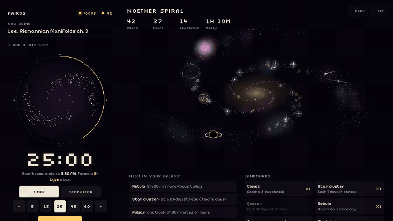
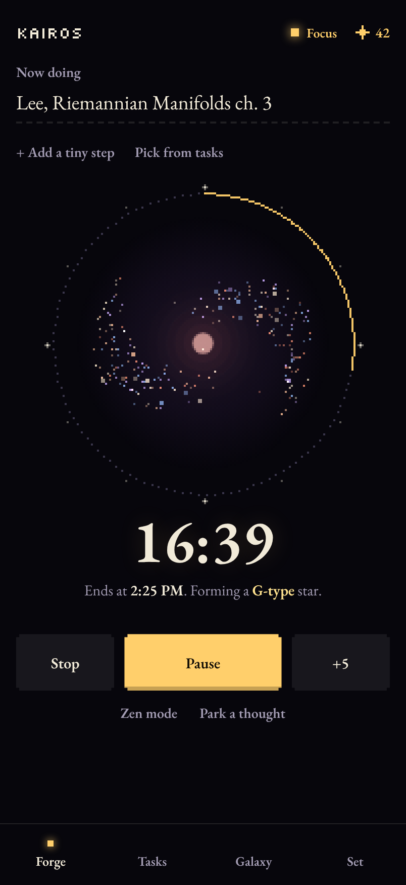
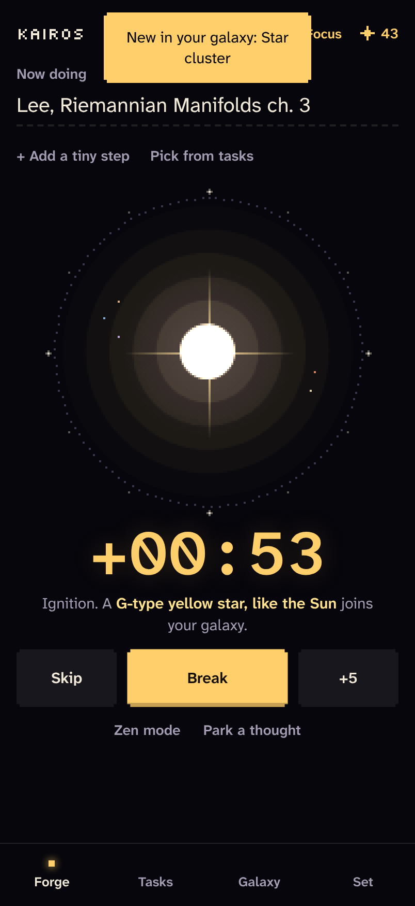
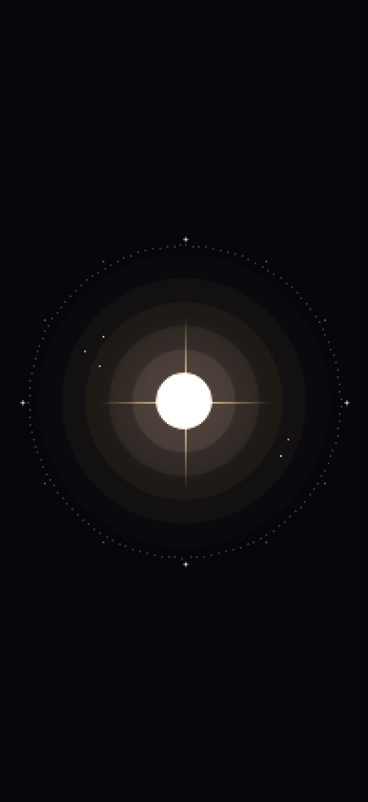
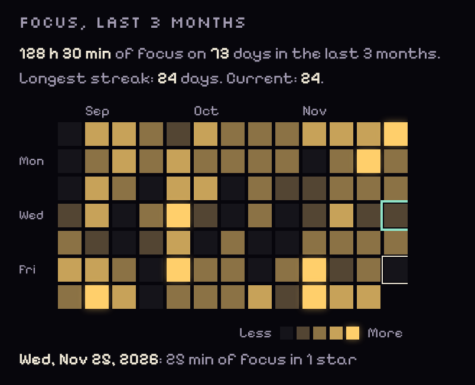
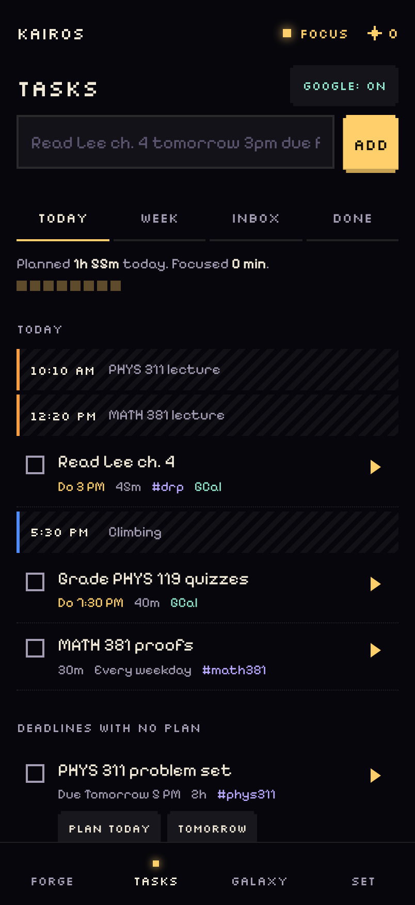
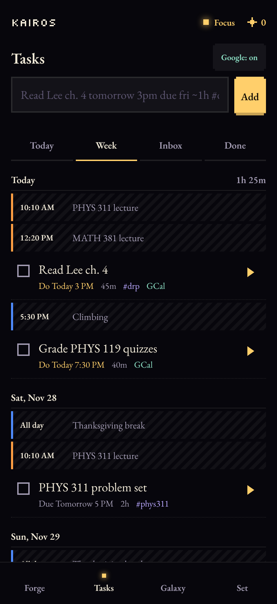
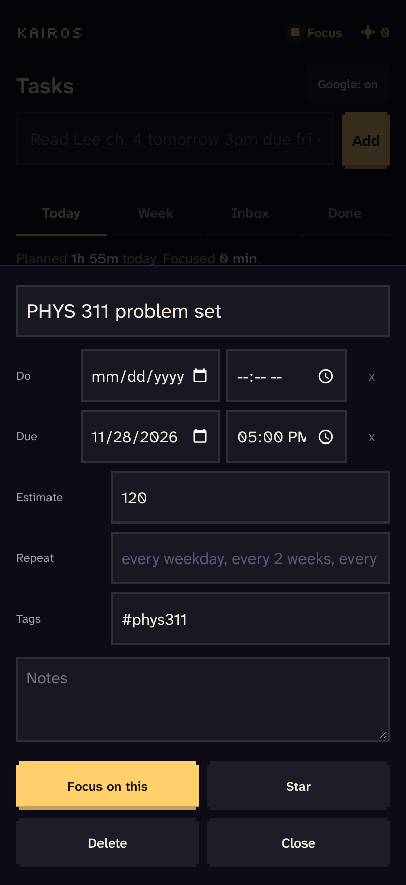
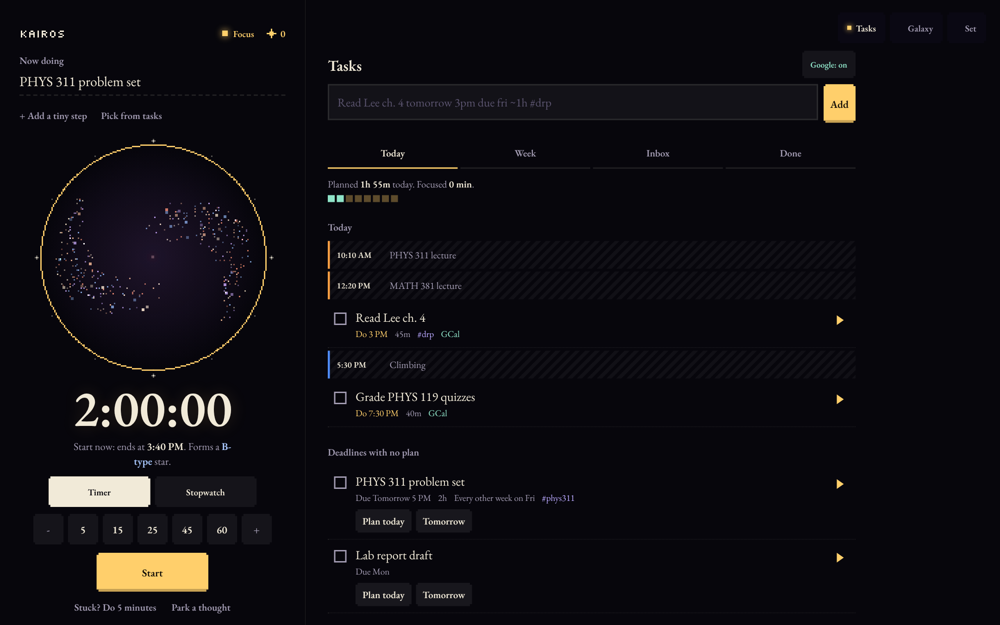

# Kairos

A cosmic pixel focus timer and task planner made for ADHD brains. Each focus block pulls a cloud of matter into a star. When the block ends, the star ignites and joins your galaxy. Kairos runs as a home-screen web app on iPhone and in any browser on a computer.

**Open the app:** https://thescholium.github.io/Kairos/

[Watch the full-quality demo video (MP4, 25 s)](docs/kairos-demo.mp4). The video uses a fast clock: each 25-minute block takes a few seconds. All stars and tasks in the video and screenshots are sample data.

## Screenshots

| Forge (timer running) | Ignition | Galaxy |
|:---:|:---:|:---:|
|  |  |  |

| Zen mode | Stopwatch |
|:---:|:---:|
|  |  |

**3-month heatmap** (sample data)

| Tasks: Today | Tasks: Week | Task |
|:---:|:---:|:---:|
|  |  |  |

**Computer layout:** the forge is on the left. The right side shows the galaxy or your tasks.

## What it does

- **Visual timer for time blindness.** A ring shows the time left, clockwise from the top, on a 60-minute face. The text shows the clock time when the block ends.
- **Protostar forge.** Gas spirals into the core. The core grows and gets hotter as the block goes on. At the end, the star ignites.
- **Stopwatch.** Counts up with no end. Tap Done to form the star (5 minutes or more). It chimes every 30 minutes.
- **Zen mode.** After you start, tap the forge. Only the star and its ring stay on the screen. Tap again to leave.
- **The 3-minute rule.** During a focus block, if you leave the app (close it, change tabs, lock the phone) for 3 minutes or more, the matter drifts off and the star does not form. A pause also holds for only 3 minutes. Breaks have no limit.
- **Star types come from block length:** M red dwarf (under 10 min), K (10+), G like the Sun (25+), F (45+), A (60+), B blue giant (90+), O blue supergiant (150+). If you stop a timer block yourself after 5 minutes or more, you get a brown dwarf.
- **3-month heatmap** on the Galaxy tab, like the one on a GitHub profile: one square per day for the last 13 weeks, brighter for more focus minutes. It shows total hours, active days, and your longest and current streak. Tap a day to see its time and stars.
- **Landmarks:** comet (3-day streak), star cluster (each 7 days of streak), quasar (each 30 days), nebula (4 h in one day), supernova remnant (8 h), black hole (12 h), pulsar (one block of 90 min or more).
- **ADHD helpers:** one "Now doing" task with up to five tiny steps, a "Do 5 minutes" start, a parking lot for stray thoughts, halfway and 5-minute chimes, and a screen wake lock.
- **Tasks with two dates.** Each task can have a **do date** (the day, and if you want the time, you plan to work on it) and a **due date** (the deadline). The task engine is the core of [Ephemeris](https://github.com/TheScholium/ephemeris), so quick add, repeats and the Today logic work the same way.
- **Today** shows late tasks, plans that slipped from earlier days (one tap moves them all to today), today's plan in time order beside your Google Calendar events, what is due today, and deadlines in the next 7 days that have no plan yet. A row of squares shows your planned load; mint squares are done.
- **Week** shows the next 7 days: events, planned tasks, deadlines, and the future dates of repeating tasks.
- **Inbox** holds tasks with no dates. "Park a thought" during a block puts the thought here.
- **Focus on a task.** The play button on a task (or "Pick from tasks" on the forge) makes it "Now doing" and sets the timer to its estimate. Each star you make then counts toward that task.
- **Google Calendar.** See your events beside your tasks, and send planned tasks with a time to your calendar as events (length = estimate). This runs in your browser with your own Google sign-in; there is no server.
- **Sync** of the galaxy and tasks between your phone and your computer through a private GitHub gist.
- **Works offline** after the first visit.

## Install

### iPhone

1. Open https://thescholium.github.io/Kairos/ in Safari.
2. Tap Share > Add to Home Screen. Make sure "Open as Web App" is on.

### Mac

Open the same address in Safari, then choose File > Add to Dock. In Chrome, use the install icon in the address bar.

### Your own copy

Fork this repository. Then go to Settings > Pages, set Source to "Deploy from a branch", branch `main`, folder `/ (root)`, and save.

## Quick add

| You type | Result |
|---|---|
| `tomorrow 9am`, `fri`, `next mon`, `oct 28`, `in 3 days` | Do date and time |
| `due fri 5pm`, `by oct 30` | Due date |
| `3-5pm`, `at 2:30` | Do time (a range also sets the estimate) |
| `for 45m`, `~1h30`, `(2h)` | Estimate |
| `every weekday`, `every mon, wed`, `every 2 weeks`, `every 3 days after done` | Repeat |
| `#drp`, `#school/phys311` | Tags |
| `!` | Star |
| `"Read Sunday Times"` | Quoted text stays in the title |

Example: `Read Lee ch. 4 tomorrow 3pm due fri ~1h #drp`. On a computer, press `n` to add a task.

## Connect Google Calendar (one time, about 5 minutes)

Kairos talks to Google Calendar from your browser with a Google sign-in. Google needs an "OAuth client" that says which website may ask. You make it once, free:

1. Open https://console.cloud.google.com/ and make a new project (for example `Kairos`).
2. Go to **APIs & Services > Library**, find **Google Calendar API**, and select **Enable**.
3. Go to **APIs & Services > OAuth consent screen** (Google may call it **Google Auth Platform > Branding / Audience**). Choose **External**, give the app a name, and add your own Gmail address as a **test user**. You do not need to publish the app.
4. Go to **Credentials > Create credentials > OAuth client ID**. Choose **Web application**.
   - **Authorized JavaScript origins:** `https://thescholium.github.io`
   - **Authorized redirect URIs:** `https://thescholium.github.io/Kairos/` (Kairos Settings shows the exact address to copy; it must match, with the slash at the end).
5. Copy the **Client ID**. In Kairos, go to **Settings > Google Calendar**, paste it, and select **Connect**. Sign in and allow access.

After that:

- **Tasks** shows your events (striped rows). In Settings, pick which calendars to show and which calendar gets your tasks.
- A task with a do date **and** a time goes into your calendar automatically (you can turn this off). Other tasks with a do date have an **Add to Google** button. A change to the task updates the event.
- Google signs you out of the browser connection after about an hour. Tap **Connect Google** at the top of Tasks to continue; changes made while signed out wait and then go to Google.
- The client ID syncs between your devices with the gist sync. You still sign in to Google once on each device.
- Kairos asks only for these permissions: read your calendar list, and read and change events. In testing mode, only the test users you added can sign in.

## Sync your phone and your Mac

1. Open https://github.com/settings/tokens/new?scopes=gist&description=Kairos%20sync and make a classic token with only the `gist` scope. Copy it.
2. In Kairos on the first device, go to Settings > Sync, paste the token, and tap Log in. This makes a private gist named `kairos-sync` that holds your galaxy.
3. On the second device, paste the same token. Its stars merge with the synced galaxy.

After that, each device pulls when you open it and pushes about 4 seconds after a change. The newer copy wins, so use one device at a time. The token stays in the browser storage of each device. A gist-only token cannot change your repositories.

## Update the app

Edit `index.html`, then change `V` in `sw.js` (for example to `kairos-v6`). Push. Close and open the app two times to load the new version.

## Limits

- iOS stops web apps when the screen locks, and a locked screen counts as away. Keep "Keep screen awake" on during a block.
- If the app closes, the time stays correct, because the timer uses the clock time. The end chime plays when you open the app again.
- Without sync, each browser keeps its own galaxy and tasks. If you delete the app, its data goes too.
- There are no task notifications: a web app needs a server to send them. Ephemeris has that server if you need reminders.
- Google Calendar connection and sync work from the GitHub Pages app, not from a Claude preview.

## Files

| File | Purpose |
|---|---|
| `index.html` | The app: markup, styles and script |
| `core.js` | Task engine: the Ephemeris core (parser, repeats, Today and Week views), bundled |
| `manifest.webmanifest` | Home-screen app name, colours and icons |
| `sw.js` | Offline cache |
| `icon-*.png` | App icons |
| `docs/` | Screenshots and demo video |
