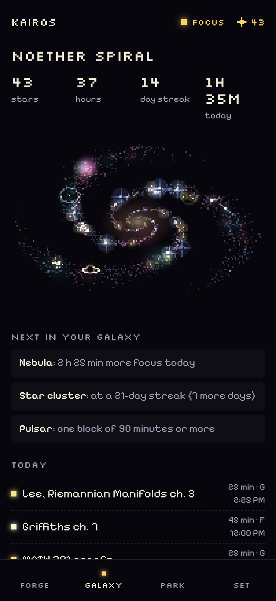
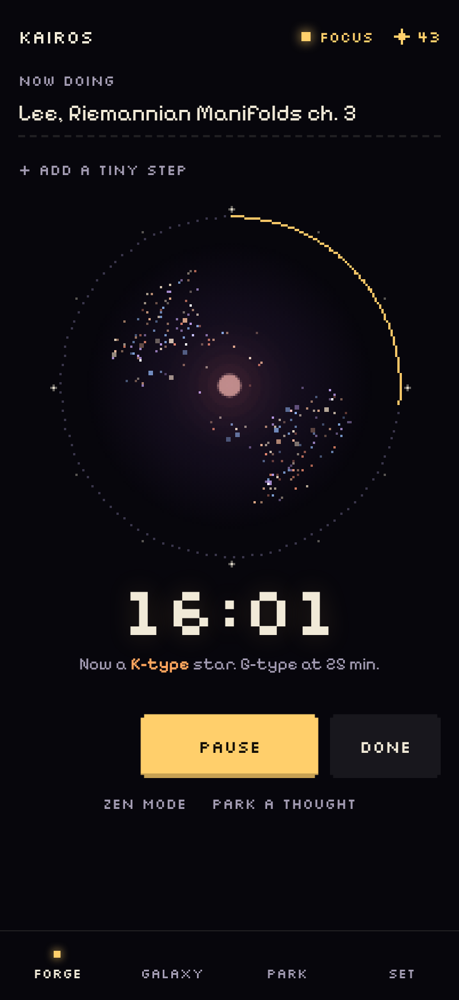
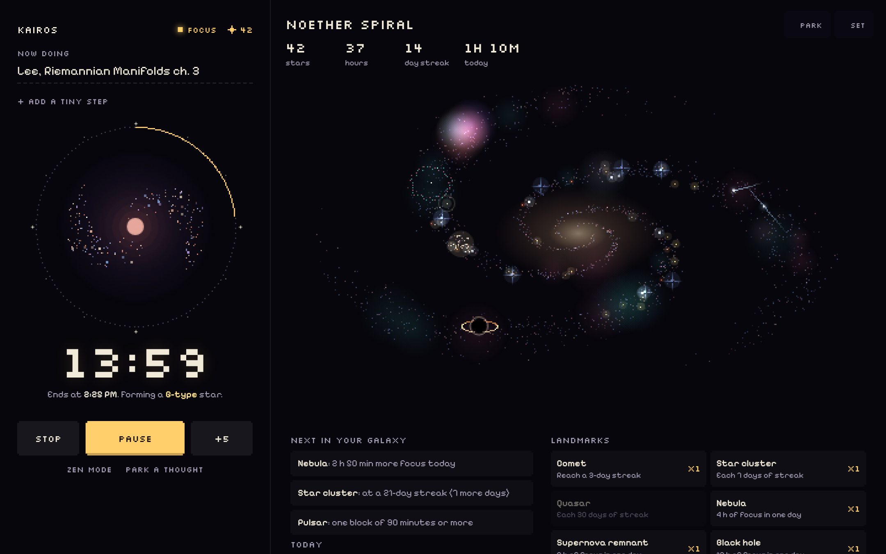

# Kairos

A cosmic pixel focus timer made for ADHD brains. Each focus block pulls a cloud of matter into a star. When the block ends, the star ignites and joins your galaxy. Kairos runs as a home-screen web app on iPhone and in any browser on a computer.

**Open the app:** https://thescholium.github.io/Kairos/

[Watch the full-quality demo video (MP4, 25 s)](docs/kairos-demo.mp4). The video uses a fast clock: each 25-minute block takes a few seconds. All stars and tasks in the video and screenshots are sample data.

## Screenshots

| Forge (timer running) | Ignition | Galaxy |
|:---:|:---:|:---:|
|  |  |  |

| Zen mode | Stopwatch |
|:---:|:---:|
|  |  |

**Computer layout:** the forge is on the left and the galaxy fills the right side.

## What it does

- **Visual timer for time blindness.** A ring shows the time left, clockwise from the top, on a 60-minute face. The text shows the clock time when the block ends.
- **Protostar forge.** Gas spirals into the core. The core grows and gets hotter as the block goes on. At the end, the star ignites.
- **Stopwatch.** Counts up with no end. Tap Done to form the star (5 minutes or more). It chimes every 30 minutes.
- **Zen mode.** After you start, tap the forge. Only the star and its ring stay on the screen. Tap again to leave.
- **The 3-minute rule.** During a focus block, if you leave the app (close it, change tabs, lock the phone) for 3 minutes or more, the matter drifts off and the star does not form. A pause also holds for only 3 minutes. Breaks have no limit.
- **Star types come from block length:** M red dwarf (under 10 min), K (10+), G like the Sun (25+), F (45+), A (60+), B blue giant (90+), O blue supergiant (150+). If you stop a timer block yourself after 5 minutes or more, you get a brown dwarf.
- **Landmarks:** comet (3-day streak), star cluster (each 7 days of streak), quasar (each 30 days), nebula (4 h in one day), supernova remnant (8 h), black hole (12 h), pulsar (one block of 90 min or more).
- **ADHD helpers:** one "Now doing" task with up to five tiny steps, a "Do 5 minutes" start, a parking lot for stray thoughts, halfway and 5-minute chimes, and a screen wake lock.
- **Sync** between your phone and your computer through a private GitHub gist.
- **Works offline** after the first visit.

## Install

### iPhone

1. Open https://thescholium.github.io/Kairos/ in Safari.
2. Tap Share > Add to Home Screen. Make sure "Open as Web App" is on.

### Mac

Open the same address in Safari, then choose File > Add to Dock. In Chrome, use the install icon in the address bar.

### Your own copy

Fork this repository. Then go to Settings > Pages, set Source to "Deploy from a branch", branch `main`, folder `/ (root)`, and save.

## Sync your phone and your Mac

1. Open https://github.com/settings/tokens/new?scopes=gist&description=Kairos%20sync and make a classic token with only the `gist` scope. Copy it.
2. In Kairos on the first device, go to Settings > Sync, paste the token, and tap Log in. This makes a private gist named `kairos-sync` that holds your galaxy.
3. On the second device, paste the same token. Its stars merge with the synced galaxy.

After that, each device pulls when you open it and pushes about 4 seconds after a change. The newer copy wins, so use one device at a time. The token stays in the browser storage of each device. A gist-only token cannot change your repositories.

## Update the app

Edit `index.html`, then change `V` in `sw.js` (for example to `kairos-v5`). Push. Close and open the app two times to load the new version.

## Limits

- iOS stops web apps when the screen locks, and a locked screen counts as away. Keep "Keep screen awake" on during a block.
- If the app closes, the time stays correct, because the timer uses the clock time. The end chime plays when you open the app again.
- Without sync, each browser keeps its own galaxy. If you delete the app, its data goes too.

## Files

| File | Purpose |
|---|---|
| `index.html` | The full app: markup, styles and script in one file |
| `manifest.webmanifest` | Home-screen app name, colours and icons |
| `sw.js` | Offline cache |
| `icon-*.png` | App icons |
| `docs/` | Screenshots and demo video |
